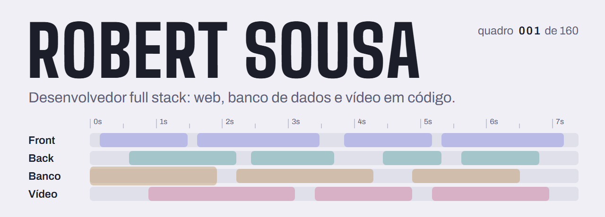

<picture>
  <source media="(prefers-color-scheme: dark)" srcset="assets/banner-escuro.gif">
  <source media="(prefers-color-scheme: light)" srcset="assets/banner-claro.gif">
  
</picture>

Sou desenvolvedor full stack júnior. Faço produtos web com React, Next.js e Supabase, e também faço vídeo escrevendo código, com Remotion.

O banner acima é um desses vídeos: escrevi em React e renderizei com Remotion. O código está na pasta [`banner/`](banner).

## O que eu uso

<picture>
  <source media="(prefers-color-scheme: dark)" srcset="assets/stack-escuro.svg">
  <source media="(prefers-color-scheme: light)" srcset="assets/stack-claro.svg">
  
</picture>

Nos testes uso Vitest e Playwright. Os produtos web ficam no ar pela Vercel.

## Projetos

<a href="https://veylo-kappa.vercel.app">
  <picture>
    <source media="(prefers-color-scheme: dark)" srcset="assets/projeto-veylo-escuro.svg">
    <source media="(prefers-color-scheme: light)" srcset="assets/projeto-veylo-claro.svg">
    
  </picture>
</a>

Conversor de arquivos por link: você cola o link, escolhe o formato e baixa. O front é em Next.js, com Supabase e Tailwind CSS. A API é um serviço separado em Express, empacotado com Docker.

Veja o [Veylo no ar](https://veylo-kappa.vercel.app), o [código do front](https://github.com/trebor046/Veylo) e o [código da API](https://github.com/trebor046/Veylo-api).

<a href="https://sala-tec.vercel.app">
  <picture>
    <source media="(prefers-color-scheme: dark)" srcset="assets/projeto-sala-tec-escuro.svg">
    <source media="(prefers-color-scheme: light)" srcset="assets/projeto-sala-tec-claro.svg">
    
  </picture>
</a>

Sistema para controlar as 11 telas de uma sala de tecnologia pelo navegador. É feito em Next.js com Supabase, e parte das regras roda no próprio banco, em funções PL/pgSQL.

Veja o [Sala Tec no ar](https://sala-tec.vercel.app). O código é privado.

<a href="banner">
  <picture>
    <source media="(prefers-color-scheme: dark)" srcset="assets/projeto-videos-escuro.svg">
    <source media="(prefers-color-scheme: light)" srcset="assets/projeto-videos-claro.svg">
    
  </picture>
</a>

Vídeos animados e narrados que eu produzo como software: cada cena é um componente React, o Remotion renderiza, e a narração é gerada em Python. Quando a cena pede 3D, uso Three.js.

Os repositórios desses vídeos são privados. O exemplo aberto é o banner deste perfil, na pasta [`banner/`](banner).

## Experiência

**Desenvolvedor Full Stack Júnior na AUREA** (até set. 2026)

Trabalhei em CRM, dashboards, landing pages e integrações com IA. Em um caso de performance, reescrevi consultas que ignoravam o índice, e a resposta caiu de cerca de 7 s para cerca de 600 ms.

## Contato

Meu histórico completo e o melhor jeito de falar comigo estão no [LinkedIn](https://www.linkedin.com/in/robert-fsousa/).
